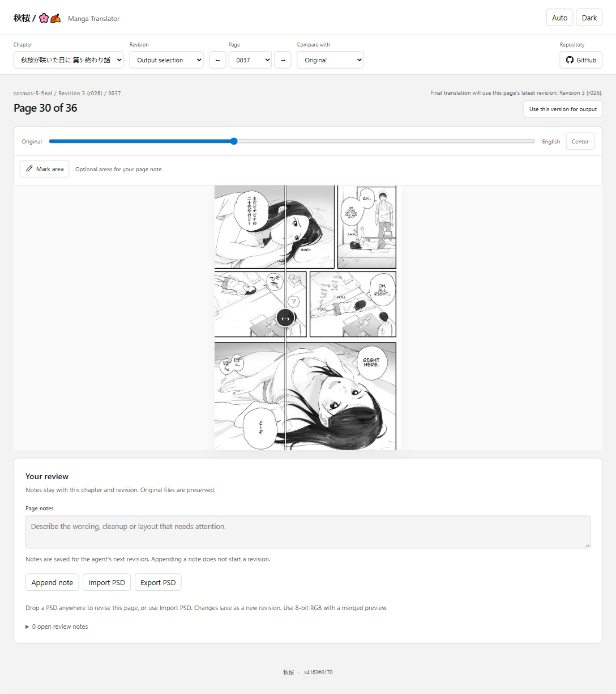

<p align="center">
  
</p>

# 秋桜 / 🌸🍂

Translate and letter manga with an agent. Review pages in the browser, ask for revisions or edit layered PSDs yourself, then export the finished chapter.

## Start a chapter

Open this repository in your coding assistant and send:

```text
Follow PROMPT.md to translate and letter this chapter.
Chapter: <chapter name or slug>
Source archive or scans folder: <existing path, if already available>
```

The agent sets up the tools, checks the Japanese transcript against the scans, then translates and letters the chapter. It asks you about uncertain readings and opens the review app when the pages are ready.

Supply an existing archive or scans folder, or place the files under `input/<chapter>/` when asked. The agent reuses existing chapter work and preserves your original scans.

## Review pages

The agent gives you the review app's URL (http://localhost:8765/). Completed revisions and addressed notes update without a page reload.

<p align="center">
  
</p>

- Compare each page with its original or an earlier revision using Compare with and the comparison slider.
- Leave feedback in chat or save it with `Append note`. To mark specific areas, draw boxes with `Mark area`, then choose Write note. Saved notes wait for the agent's next review pass. Remove note withdraws a request.
- Output selection shows what will be exported. Each page follows its latest completed version unless you choose `Use this version for output`. `Use latest` clears that choice. Browsing older versions does not change the output.

## Edit a PSD

Choose `Export PSD` to edit a page in your image editor. Each PSD has separate raster layers for English text, cleanup paint and the locked original.

Save an 8-bit RGB PSD with a merged compatibility preview. Drop it onto the review app or choose `Import PSD`. The import applies to the displayed page and saves changes as a new revision. Other pages and any versions you selected for output stay in place.

You can alternate manual edits with agent revisions. Eligible imports offer `Discard page revision` on the page they changed.

## Export the chapter

Tell the agent when you are finished. It asks whether you want the full output suite or just a ZIP of the flattened pages, unless you have already specified.

The full suite includes flattened PNGs, the chapter ZIP and available PSDs for the selected pages. Both options use your exact output selection, including manual edits. Originals and working files stay in the project.

The bundled `projects/cosmos-5-final/` chapter, 秋桜が咲いた日に 第5-終わり話, is a review/export example. It includes historical page versions and final output, but not the native inputs needed to resume agent rendering.

## Guides

- [Agent entry point](PROMPT.md)
- [Environment setup](.agents/setup.md)
- [Commands and chapter workflow](.agents/workflow.md)
- [Page lettering](.agents/skills/lettering/SKILL.md)
- [Ownership and storage](.agents/architecture.md)

Storage budget: ~0.3 GB for the code and engine checkout, plus ~10 GB for the bundled `cosmos-5-final` example. Allow ~10-20 GB for installed prerequisites, dependencies and model downloads, and ~10-30 GB per active chapter for agent revisions and manual PSD edits. Plan for ~30-60 GB total with the example and one active chapter, give or take. GPU packages, larger scans and longer revision histories can need more.

Requires Python 3.11+, Node.js 20+, Git and FFmpeg. The agent sets up a separate Python 3.12 environment for the pinned engine. You need an image editor only for manual PSD edits.

## Engine and license

This project uses [hgmzhn/manga-translator-ui](https://github.com/hgmzhn/manga-translator-ui) for OCR, inpainting and text rendering. The engine is pinned as the `manga-translator-ui/` submodule. This repository adds the agent workflow, chapter records, browser review, manual PSD revisions and final export.

Copyright © 2026 bloom-tl contributors. This repository's software is licensed under [GNU GPL-3.0](LICENSE), matching the engine's [license](https://github.com/hgmzhn/manga-translator-ui/blob/a194a54b397782de1aafaf1684f039624e2229d1/LICENSE.txt). Third-party dependencies and models retain their own licenses. Manga scans, artwork and chapter content are outside this software license; their rights remain with their respective owners.
